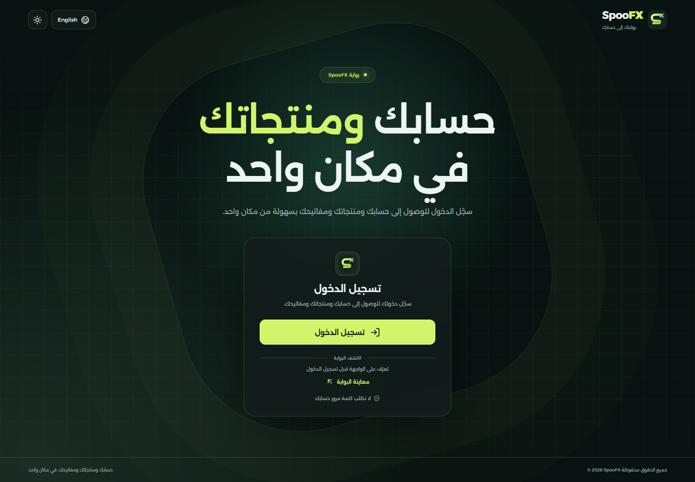
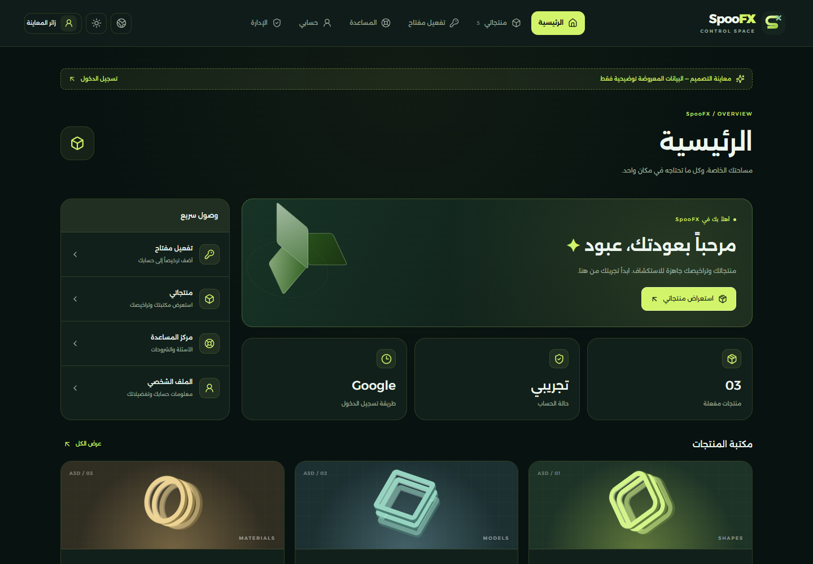

# SpooFX

واجهة SpooFX مستقلة للمستودع `ABOOD-3D`. تتضمن صفحة دخول مركزية وشريط تنقل علوي وهوية خضراء داكنة مختلفة عن التصميم المرجعي.





## ما تتضمنه النسخة

- صفحة دخول ولوحة بوابة بتصميم جديد باسم **SpooFX**.
- الرئيسية، منتجاتي، تفعيل المفتاح، مركز المساعدة، الملف الشخصي، ومعاينة قوائم الإدارة.
- العربية والإنجليزية، الوضع الداكن والفاتح، قائمة جوال قابلة للإغلاق بلوحة المفاتيح.
- تسجيل دخول Google فعلي عبر NextAuth، مع جلسة مشفّرة وحماية صفحة `/portal` على الخادم.
- معاينة عامة على `/preview` ببيانات توضيحية فقط. هذه الصفحة لا تمنح صلاحيات أو جلسات دخول.

هذه **نسخة تصميم**: لم يتم نقل قاعدة البيانات أو العملاء أو مفاتيح المنتجات أو خدمة التفعيل أو التحميل أو الدفع أو نظام الدعم الخاص بالموقع المرجعي. نماذج المنتجات في المعاينة ليست منتجات للبيع. صفحة التفعيل لا تحفظ أو ترسل المفاتيح ولا تدّعي نجاح التفعيل. قوائم الإدارة للمعاينة فقط ولا تحتوي على عمليات إدارية فعلية.

## التشغيل

يتطلب Node.js 22 أو أحدث.

```sh
npm ci
npm run dev
```

افتح `http://localhost:3000`. يمكن تشغيل التصميم والمعاينة بدون أي مفاتيح. زر قوقل يعرض رسالة واضحة عندما لا تكون الخدمة مهيأة.

على Windows تجنّب وجود الرمز `#` في مسار المشروع؛ قد يسبب خللاً في بناء ملفات React أو تحميل CSS في Next.js. يمكن استخدام مجلد مثل `C:\projects\ABOOD-3D`، أو قرص افتراضي يشير إلى المجلد الأب ثم الدخول إلى مجلد المشروع الفرعي.

## تفعيل تسجيل الدخول باستخدام قوقل

1. أنشئ مشروع Google Cloud خاصاً بـ SpooFX، وجهّز شاشة موافقة OAuth. إذا كان التطبيق في وضع الاختبار، أضف حسابات الاختبار.
2. أنشئ OAuth Client من نوع **Web application**.
3. أضف مسار إعادة التوجيه المحلي `http://localhost:3000/api/auth/callback/google`، وبعد النشر أضف نفس المسار تحت نطاق موقعك الفعلي.
4. انسخ `.env.example` إلى `.env.local` وأضف القيم الخاصة بمشروعك فقط:

```dotenv
GOOGLE_CLIENT_ID=
GOOGLE_CLIENT_SECRET=
NEXTAUTH_SECRET=
NEXTAUTH_URL=http://localhost:3000
```

أنشئ `NEXTAUTH_SECRET` عشوائياً على جهازك:

```sh
node -e "console.log(require('node:crypto').randomBytes(32).toString('base64'))"
```

لا تضع هذه القيم في GitHub ولا ترسلها في المحادثات. على الاستضافة أضفها عبر إعدادات متغيرات البيئة، واجعل `NEXTAUTH_URL` عنوان الموقع الفعلي بـ HTTPS. لا تحتاج النسخة إلى مفاتيح من المشروع المرجعي.

مرجع الإعداد: [Google provider — NextAuth](https://next-auth.js.org/providers/google).

## البناء والنشر

```sh
npm run build
npm start
```

يمكن استيراد المستودع في استضافة تدعم Next.js وخادم Node.js. على Vercel اختر إعداد Next.js الافتراضي وأضف متغيرات البيئة السابقة. **GitHub Pages لا يشغّل تسجيل الدخول هذا** لأنه يحتاج إلى خادم؛ رفع الكود إلى GitHub لا ينشر الموقع تلقائياً.

## التحقق

```sh
npm run build
npm test
```

تختبر الاختبارات التنقل والبحث واللغة والمظهر وقائمة الجوال، وحماية صفحة الحساب، وحالة Google غير المهيأة، وإنشاء طلب OAuth مع CSRF وPKCE. تستخدم اختبارات OAuth بيانات اختبار مؤقتة داخل الذاكرة فقط ولا تسجّل الدخول إلى حساب حقيقي. يلزم اختبار تسجيل الدخول الكامل بحساب قوقل بعد إضافة بيانات المشروع الحقيقية.

على Windows يستخدم الاختبار Chrome المثبّت. على Linux أو macOS شغّل `npx playwright install chromium` أولاً. يمكن تحديد متصفح مختلف عبر `BROWSER_CHANNEL`.

## ملفات المشروع

- `components/portal/login-page.tsx`: واجهة الدخول.
- `components/portal/portal-navigation.tsx`: القوائم الأصلية بعد التنظيف وتغيير الهوية.
- `components/portal/portal.tsx`: صفحات البوابة والمعاينة.
- `lib/auth.ts`: إعداد Google والجلسات.
- `public/brand.svg` و`public/background.svg`: أصول الهوية الجديدة.
- `public/fonts/`: خط Alexandria المحلي وترخيصه الأصلي.

لا يوجد سجل Git منسوخ أو ملفات بيئة أصلية أو ملفات تنفيذية أو أرشيفات من المستودع المرجعي. احتُفظ بإشعار ترخيص الخط فقط، وتُدار التغييرات في مستودع مستقل.
